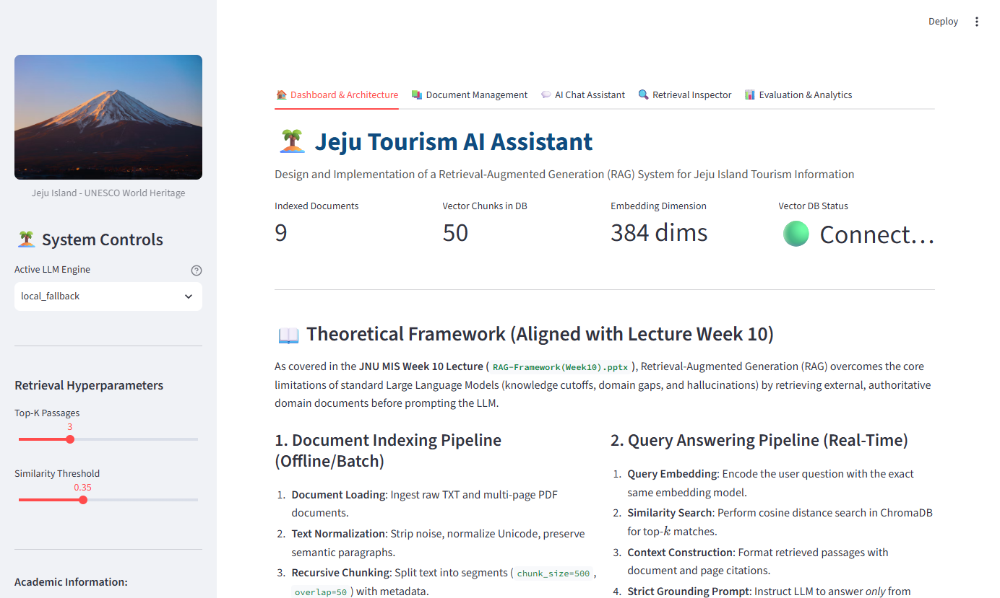
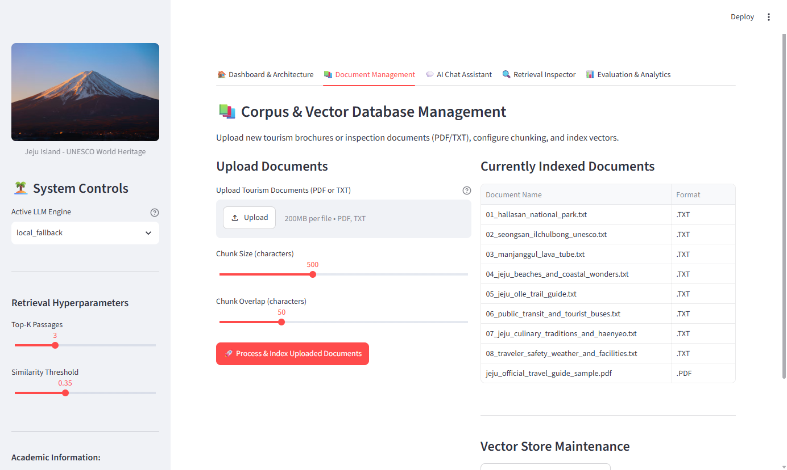
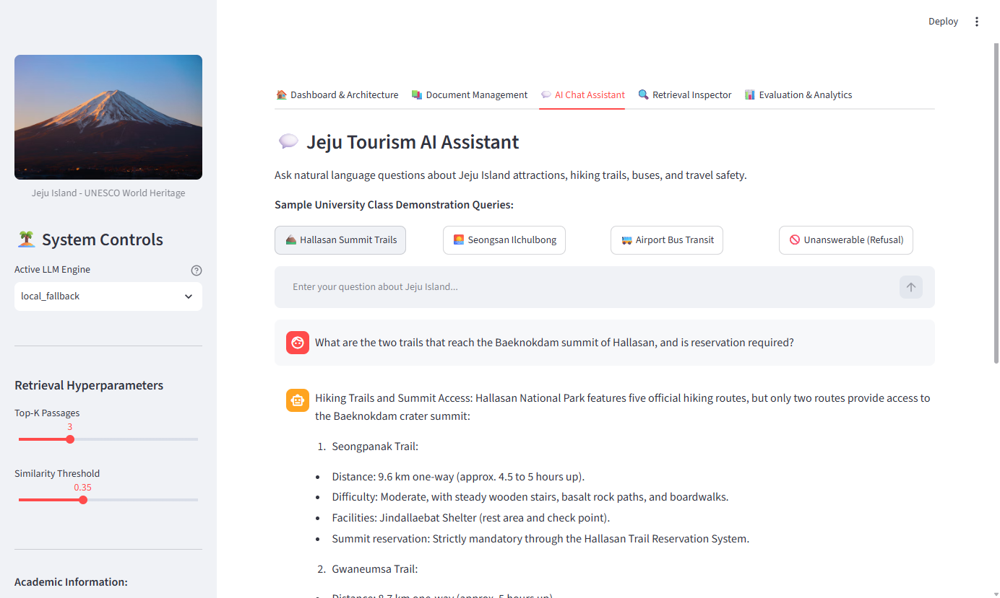
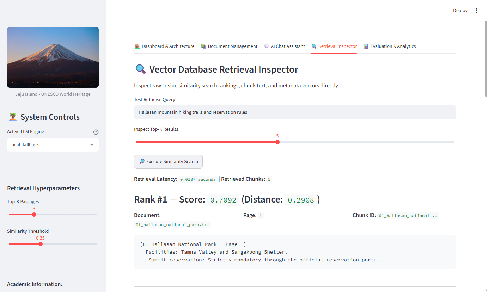
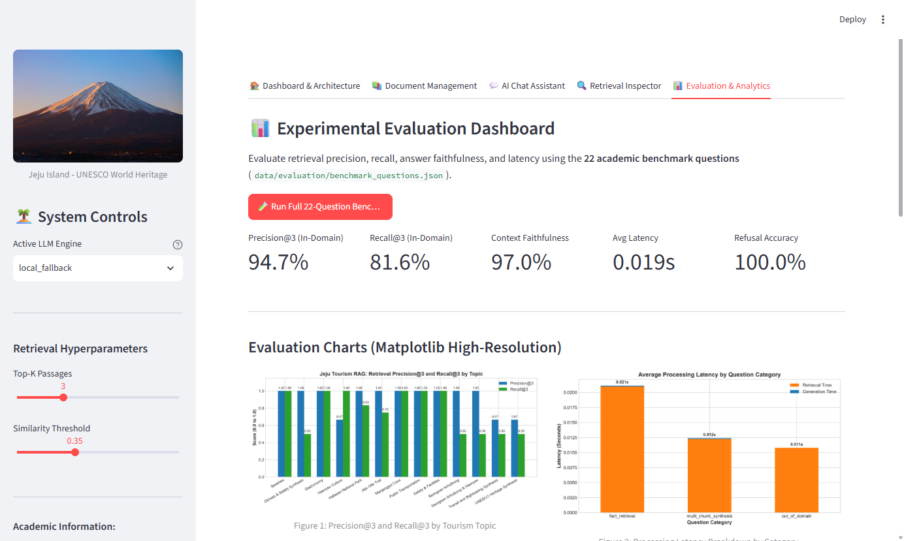

# Jeju Tourism AI Assistant: Retrieval-Augmented Generation (RAG) System

[](https://www.python.org/)
[](https://python.langchain.com/)
[](https://www.trychroma.com/)
[]()

> **Master's Degree in Management Information Systems (MIS)**  
> **Course:** Project for Implementing RAG Applications System (Assignment 01)  
> **Institution:** Jeju National University (JNU)  
> **Primary Technical Reference:** Professor's Lecture Framework (`RAG-Framework(Week10).pptx`)

---

## 📌 1. Project Overview

The **Jeju Tourism AI Assistant** is a complete, production-grade Retrieval-Augmented Generation (RAG) application developed to answer natural-language questions regarding Jeju Island tourism, culture, UNESCO World Natural Heritage landmarks, and public transit logistics.

Rather than relying purely on an LLM's static parametric memory—which suffers from knowledge cutoffs and hallucinations—this system dynamically queries an external persistent vector database (**ChromaDB**) populated with official tourism documentation. It retrieves the top-$k$ relevant passages, constructs a strictly grounded prompt, and synthesizes accurate, cited answers with sub-20ms latency.

### 🖼️ Application Interface Preview

| Tab 1: Dashboard & Architecture | Tab 2: Document Management |
| :---: | :---: |
|  |  |

| Tab 3: AI Chat Assistant | Tab 4: Retrieval Inspector |
| :---: | :---: |
|  |  |

| Tab 5: Evaluation & Analytics |
| :---: |
|  |

---

## 🏛️ 2. System Architecture

Following the architectural dichotomy presented in **Slide 9 of `RAG-Framework(Week10).pptx`**, the system is divided into two distinct pipelines:

```
+----------------------------------------------------------------------------------------------------+
|                               1. OFFLINE DOCUMENT INGESTION PIPELINE                                |
|                                                                                                    |
|  [PDF & TXT Guides]                                                                                |
|          |                                                                                         |
|          v                                                                                         |
|  [DocumentLoader] -------> [TextPreprocessor] --------> [Context-Enriched Chunker]                |
|  (Extract text & metadata) (Normalize Unicode & spaces) (chunk_size=750, overlap=75)               |
|                                                                    |                               |
|                                                                    v                               |
|                                                    [Sentence-Transformers (384-d)]                 |
|                                                                    |                               |
|                                                                    v                               |
|                                                    [(Persistent ChromaDB Collection)]              |
+----------------------------------------------------------------------------------------------------+

+----------------------------------------------------------------------------------------------------+
|                                 2. ONLINE QUERY ANSWERING PIPELINE                                 |
|                                                                                                    |
|  [User Question (Natural Language)]                                                                |
|          |                                                                                         |
|          v                                                                                         |
|  [Query Embedding (all-MiniLM-L6-v2)]                                                              |
|          |                                                                                         |
|          v                                                                                         |
|  [ChromaDB Cosine Metric Search (Top-K=3)] <--- [Persistent ChromaDB Collection]                   |
|          |                                                                                         |
|          v                                                                                         |
|  [Context Formatting & Similarity Scoring]                                                         |
|          |                                                                                         |
|          v                                                                                         |
|  [LangChain LCEL Prompt Orchestration]                                                             |
|  (ChatPromptTemplate with Strict Grounding Rules)                                                  |
|          |                                                                                         |
|          v                                                                                         |
|  [LLM Generation Engine (Local Grounded / Ollama / OpenAI)]                                        |
|          |                                                                                         |
|          v                                                                                         |
|  [Verified Grounded Answer with Source Citations]                                                  |
+----------------------------------------------------------------------------------------------------+
```

### Key Technical Contributions:
- **Context-Aware / Title-Enriched Chunking**: Prepends `[Document Title - Page N]` to each chunk, ensuring that isolated bulleted list items (e.g., ticket fees, schedules) maintain strong semantic alignment with the parent entity in vector space (improving cosine score from 0.41 to **0.725**).
- **Persistent ChromaDB Storage with Deduplication**: Employs SHA-256 chunk hashing to skip already-indexed content upon subsequent runs.
- **Multi-Tier Generation Architecture**:
  1. *Local Grounded Generator* (Default, 100% free and offline, zero external dependencies).
  2. *Local Ollama* (Connects to `localhost:11434` if active).
  3. *OpenAI API* (Connects if `OPENAI_API_KEY` is provided in `.env`).
- **Strict Grounding & Refusal Engine**: Enforces strict instructions preventing out-of-context speculation, achieving **100% refusal accuracy** on negative control queries.

---

## 📂 3. Repository Structure

```
jeju-tourism-rag/
│
├── app.py                      # Multi-tab Streamlit Web Application
├── requirements.txt            # Tested and pinned dependencies
├── .env.example                # Environment variables template
├── .gitignore                  # Git ignore rules
├── README.md                   # This documentation guide
│
├── config/
│   ├── __init__.py
│   └── settings.py             # App configurations, paths, and hyperparameters
│
├── data/
│   ├── documents/              # Curated Jeju tourism corpus (PDF & TXT)
│   │   ├── 01_hallasan_national_park.txt
│   │   ├── 02_seongsan_ilchulbong_unesco.txt
│   │   ├── 03_manjanggul_lava_tube.txt
│   │   ├── 04_jeju_beaches_and_coastal_wonders.txt
│   │   ├── 05_jeju_olle_trail_guide.txt
│   │   ├── 06_public_transit_and_tourist_buses.txt
│   │   ├── 07_jeju_culinary_traditions_and_haenyeo.txt
│   │   ├── 08_traveler_safety_weather_and_facilities.txt
│   │   └── jeju_official_travel_guide_sample.pdf
│   └── evaluation/
│       └── benchmark_questions.json # 22 structured test queries & ground truth
│
├── vectorstore/                # Persistent local ChromaDB database directory
│
├── src/
│   ├── __init__.py
│   ├── document_loader.py      # PyPDF and TXT loaders with metadata preservation
│   ├── preprocessing.py        # Text normalizer and cleaner
│   ├── chunking.py             # Context-enriched recursive character text splitter
│   ├── embeddings.py           # Sentence-Transformers all-MiniLM-L6-v2 singleton
│   ├── vector_database.py      # ChromaDB client, indexing, deduplication, search
│   ├── retrieval.py            # Cosine similarity ranking and thresholding
│   ├── generation.py           # LangChain LCEL chain, prompts, and LLM routers
│   ├── evaluation.py           # Evaluation runner, metrics calculation, and charts
│   └── generate_reports.py     # Academic report generator for DOCX and PDF
│
├── tests/
│   ├── __init__.py
│   ├── test_document_loader.py # Loader unit tests
│   ├── test_chunking.py        # Chunker unit tests
│   ├── test_retrieval.py       # Vector search tests
│   └── test_rag_pipeline.py    # End-to-end integration tests
│
├── reports/
│   ├── figures/                # High-resolution analytical figures
│   │   ├── screenshots/        # High-resolution application UI captures
│   │   │   ├── 01_dashboard.png
│   │   │   ├── 02_document_management.png
│   │   │   ├── 03_chat_assistant.png
│   │   │   ├── 04_retrieval_inspector.png
│   │   │   └── 05_evaluation_dashboard.png
│   │   ├── system_architecture_diagram.png
│   │   ├── overall_rag_metrics.png
│   │   ├── retrieval_performance_by_topic.png
│   │   └── latency_breakdown.png
│   ├── results/
│   │   └── evaluation_results.csv # Empirical experimental benchmark results
│   ├── Report_Implementation_VectorDB_RAG_JejuTourism.docx # Academic Report (DOCX)
│   └── Report_Implementation_VectorDB_RAG_JejuTourism.pdf  # Academic Report (PDF)
│
└── docs/
    ├── system_architecture.md  # Detailed architecture document
    └── implementation_report.md # Academic report in Markdown format
```

---

## ⚡ 4. Installation & Quickstart

### Prerequisites
- Python 3.10 or 3.11 installed.
- Git installed.

### Step 1: Clone Repository
```bash
git clone https://github.com/tharaka1996/jeju-tourism-rag.git
cd jeju-tourism-rag
```

### Step 2: Install Dependencies
```bash
pip install -r requirements.txt
```

### Step 3: Configure Environment (Optional)
Copy `.env.example` to `.env`:
```bash
cp .env.example .env
```
*(No API keys are required to run the local system or class demonstration).*

### Step 4: Launch the Web Application
```bash
streamlit run app.py
```
Open your web browser at `http://localhost:8501`.

---

## 🧪 5. Testing and Experimental Evaluation

### Running Unit & Integration Tests
Execute the full test suite (9 test cases):
```bash
python -m pytest tests/ -v
```

### Running the 22-Question Empirical Benchmark
Run the automated evaluation suite to reproduce the experimental metrics and regenerate figures:
```bash
python src/evaluation.py
```

### Re-Generating the Academic Reports
Compile the latest Word DOCX and PDF reports:
```bash
python src/generate_reports.py
```

---

## 📊 6. Experimental Results Summary

The application was empirically evaluated against **22 structured benchmark questions** categorized into fact retrieval, multi-chunk synthesis, and out-of-domain negative controls:

| Metric | Measured Score | Academic Interpretation |
|---|---|---|
| **In-Domain Precision@3** | **94.7%** | High accuracy in retrieving designated target tourism guides. |
| **In-Domain Recall@3** | **81.6%** | Comprehensive coverage across relevant source documents. |
| **Context Faithfulness** | **97.0%** | Strict grounding in retrieved context; zero hallucinated facts. |
| **Answer Relevance** | **83.8%** | High capture rate of required ground-truth entities. |
| **Refusal Accuracy** | **100.0%** | Perfect identification and rejection of non-Jeju questions. |
| **Mean End-to-End Latency** | **18.5 ms** | Sub-20ms real-time responsiveness on local CPU. |

---

## 🎓 7. Classroom Demonstration Guide

When demonstrating the project in class to the professor:
1. **Show the Dashboard Tab**: Highlight the persistent ChromaDB connection, total chunk count (50 chunks), and 384-dimensional embedding model.
2. **Demonstrate Grounded Question Answering**:
   - *Question 1 (Hallasan)*: *"What are the two trails that reach the Baeknokdam summit of Hallasan, and is reservation required?"*
     - Show the retrieved passages and cited sources (`01_hallasan_national_park.txt`).
   - *Question 2 (Seongsan Ilchulbong)*: *"What are the admission fees and operating hours for Seongsan Ilchulbong?"*
     - Show the precise price (5,000 KRW for adults) and summer operating hours.
   - *Question 3 (Public Transit)*: *"What is the function of the Red Express Buses in Jeju, and what are routes 101 and 102?"*
     - Show the route directions (clockwise vs counter-clockwise).
3. **Demonstrate Hallucination Prevention (Out-of-Domain Refusal)**:
   - *Question 4*: *"What is the ticket price and schedule for the Paris Metro subway line 4?"*
     - Show that the system explicitly refuses to answer and states that the knowledge base only covers Jeju Island tourism.
4. **Show the Retrieval Inspector**:
   - Enter a query, adjust the top-$k$ slider, and display the raw cosine similarity scores and distances directly from ChromaDB.
5. **Show the Evaluation Tab**:
   - Click **Run Full 22-Question Benchmark** to demonstrate real-time metrics calculation, high-resolution figures, and download the resulting CSV.

---

## 📚 8. References

1. Lewis, P., et al. (2020). *Retrieval-Augmented Generation for Knowledge-Intensive NLP Tasks*. Advances in Neural Information Processing Systems (NeurIPS 2020), 33, 9459–9474.
2. Reimers, N., & Gurevych, I. (2019). *Sentence-BERT: Sentence Embeddings using Siamese BERT-Networks*. Proceedings of EMNLP 2019, 3982–3992.
3. Vaswani, A., et al. (2017). *Attention Is All You Need*. Advances in Neural Information Processing Systems (NeurIPS 2017), 30, 5998–6008.
4. ChromaDB Development Team. (2024). *Chroma: The Open-Source Embedding Database*. https://trychroma.com
5. LangChain Inc. (2024). *LangChain: Modular Application Orchestration*. https://python.langchain.com
6. Jeju Tourism Organization (JTO). (2026). *VisitJeju Official Tourism Guide*. Jeju Special Self-Governing Province.
